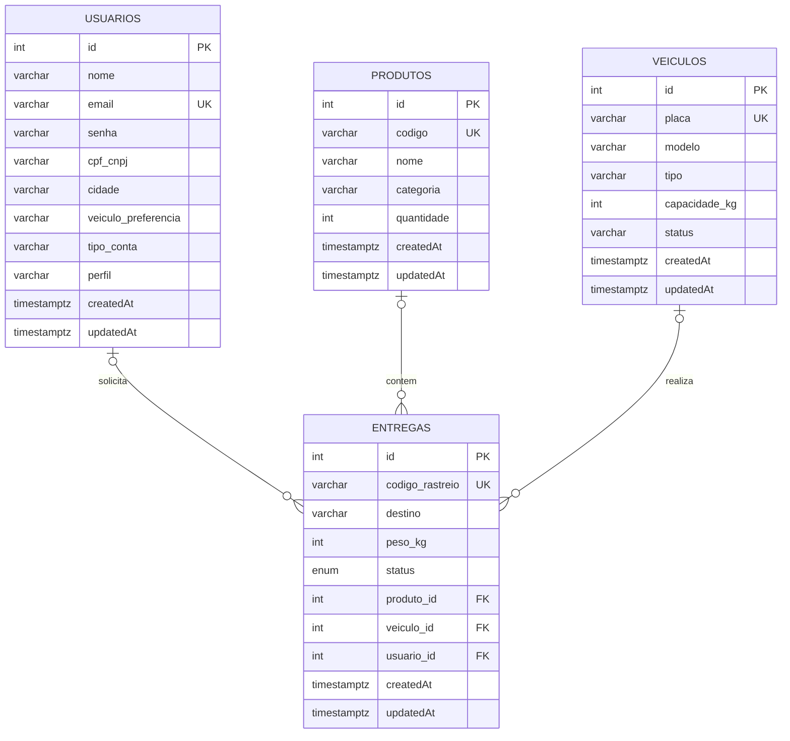

# Diagrama Entidade-Relacionamento (DER) — UrbanLink Flow

O diagrama abaixo representa o **esquema físico relacional** existente no PostgreSQL do projeto. O GitHub renderiza a notação Mermaid diretamente nesta página.

## Leitura das cardinalidades

`o|` indica participação **opcional de até um** registro associado; `o{` indica **zero a muitos**. Uma entrega pode estar sem usuário, produto ou veículo no banco por compatibilidade com registros legados, mas os fluxos normais pela API exigem um produto e identificam o usuário autenticado. A alocação de veículo pode ocorrer depois do cadastro.

O esquema é composto por **4 entidades, 4 chaves primárias e 3 chaves estrangeiras**. Os administradores são usuários com `perfil = 'administrador'`, sem quinta tabela.

- [Modelagem conceitual](modelagem_conceitual.md)
- [Modelagem lógica](modelagem_logica.md)
- [Script SQL de criação](../arquivos_adicionais/01_criar_tabelas.sql)
