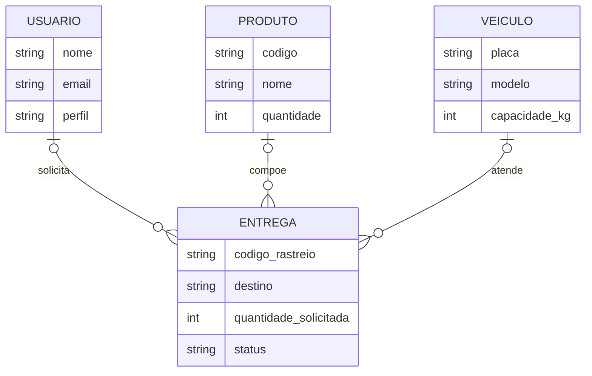

# Modelagem conceitual — UrbanLink Flow

## Finalidade

Representar os dados fundamentais da plataforma de logística, sem depender da implementação em SQL. A simulação ilustrativa de trajetos não persiste dados no banco.

## Entidades

1. **Usuário** — pessoa ou empresa cadastrada; possui dados de identificação, credenciais e perfil (`operador` ou `administrador`).
2. **Produto** — item cadastrado no estoque, identificado por código único, com categoria e quantidade disponível.
3. **Veículo** — recurso da frota, identificado pela placa, com modelo, tipo, capacidade e disponibilidade.
4. **Entrega** — solicitação identificada por código de rastreio único, destino, quantidade solicitada, status e referências a produto, veículo e usuário.

## Relacionamentos e cardinalidades

| Relacionamento | Regra de negócio |
| --- | --- |
| Usuário **solicita** Entrega | Um usuário pode solicitar nenhuma ou várias entregas; cada entrega normalmente pertence a um único usuário. A chave é opcional para compatibilidade com registros anteriores ao vínculo de usuários. |
| Produto **integra** Entrega | Um produto pode aparecer em várias entregas; uma entrega é criada com um único produto. O vínculo é anulável no banco para preservar histórico. |
| Veículo **atende** Entrega | Um veículo pode ser associado a várias entregas ao longo do tempo; a entrega pode começar sem veículo e receber uma alocação posteriormente. |

O **administrador** é um perfil da entidade Usuário, não uma tabela separada. O **estoque** é representado pelo atributo `quantidade` de Produto; ao registrar uma entrega pela API, a quantidade é abatida dentro de uma transação.

## Visão conceitual

> No banco e no código, o campo legado `peso_kg` é utilizado como **quantidade de unidades solicitadas**, apesar do nome. No modelo conceitual, ele aparece com o significado de negócio correto.

Para as tabelas, chaves primárias e estrangeiras, consulte a [modelagem lógica](modelagem_logica.md) e o [DER](DER.md).
